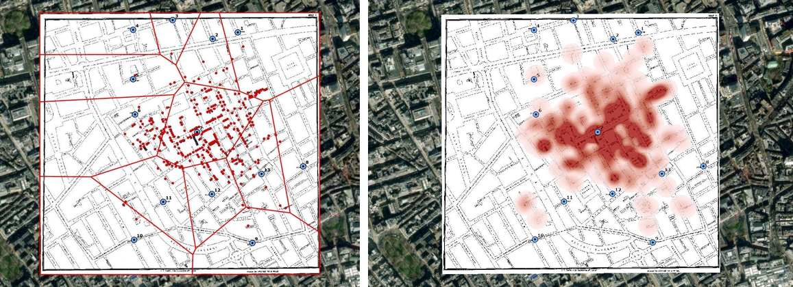
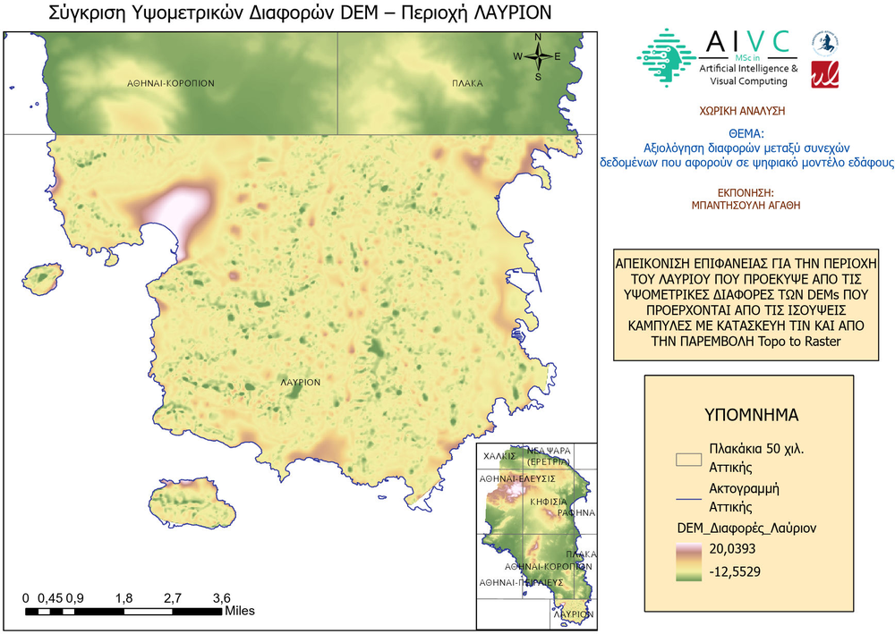
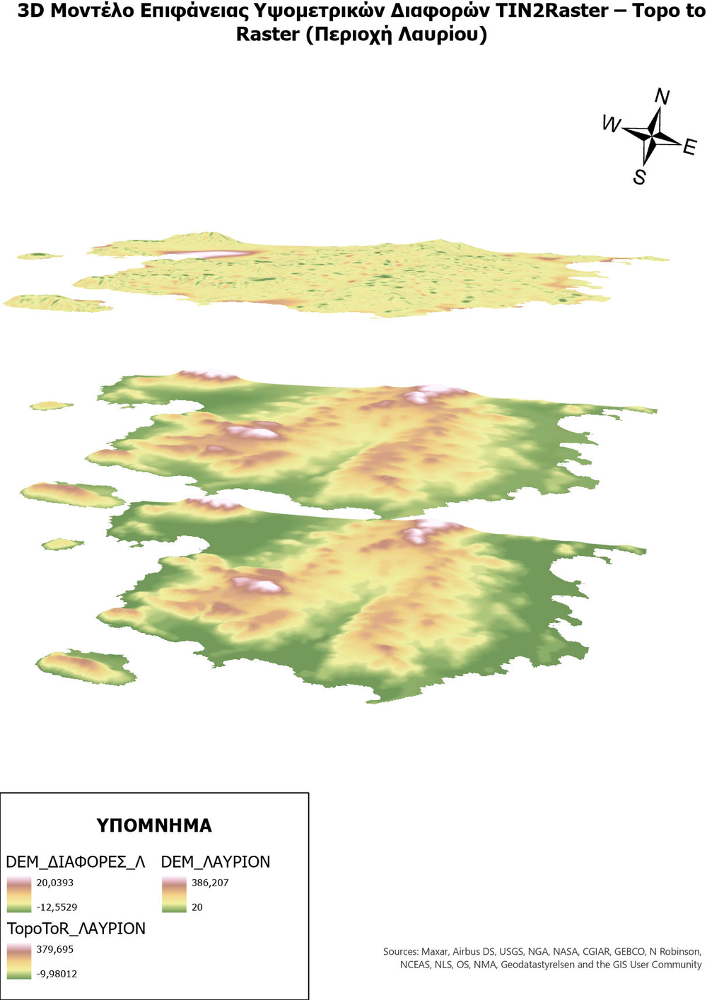
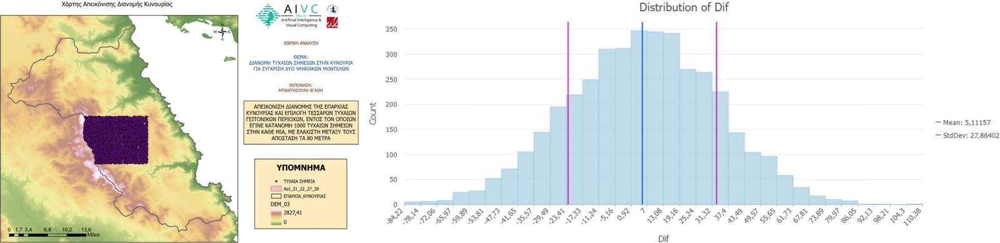

# Advanced Spatial Analysis, Viewshed Modeling & DEM Surface Assessment

Comprehensive spatial modeling workflows developed for the postgraduate course *Spatial Analysis* (MSc in Artificial Intelligence and Visual Computing), covering epidemiological spatial clustering, viewshed visibility, continuous DEM surface interpolation evaluation, and automated geoprocessing (ModelBuilder).

📄 **Project Reports & Deliverables:**

* 📄 [**1. John Snow Cholera Spatial Outbreak Analysis (PDF)**](./HW1_John_Snow_Cholera_Spatial_Analysis.pdf)
* 📄 [**2. Ancient Fortifications Viewshed & Visibility Network (PDF)**](./HW2_Viewshed_Analysis_Arcadia.pdf)
* 📄 [**3. DEM Interpolation Differencing: TIN vs. TopoToRaster (PDF)**](./HW3_DEM_Interpolation_Comparison_Lavrion.pdf)
* 📄 [**4. Automated DEM Reprojection & Error Statistics (PDF)**](./HW4_ModelBuilder_ASTER_DEM_Statistics.pdf)

---

## 📌 Project Modules

### 1. Epidemiological Clustering & Spatial Association (John Snow 1854)

* **Objective:** Empirical reproduction and spatial modeling of Dr. John Snow's 1854 London cholera outbreak study in Soho.
* **Geospatial Techniques:**
  * **Thiessen Polygons (Voronoi Diagrams):** Partitioned spatial space around water pumps into discrete zones of influence, delineating service catchments based on Euclidean proximity.
  * **Spatial Join & Summary Aggregation:** Mapped mortality records to catchment polygons; quantitatively verified that the Broad Street pump accounted for the vast majority of cases (354 deaths, average 2 per household point).
  * **Kernel Density Estimation (KDE):** Modeled continuous density surfaces (heatmaps) to identify spatial clusters without the constraints of artificial administrative boundaries.
  * **Comparative Synthesis:** Analyzed trade-offs between discrete territorial assignment (Thiessen) and continuous probability fields (KDE).

  
   <em>John Snow 1854: Thiessen polygons around water pumps (left) and kernel density of deaths (right)</em>

---

### 2. Terrain Visibility & Military Viewshed Modeling (Arcadia, Greece)

* **Objective:** Quantitative assessment of line-of-sight and strategic visibility from ancient defensive fortifications across the mountainous terrain of Arcadia.
* **Geospatial Techniques:**
  * **Viewshed Analysis:** Calculated intervisibility surfaces from 26 historical observation points draped over hillshaded topography.
  * **Network Classification:** Intersected ancient transport corridors with the cumulative viewshed, classifying 186.6 km as visible and 604.1 km as occluded/blind terrain.
  * **Proximity Modeling:** Computed Euclidean distance vectors from lookout stations to the Argolic coastline (ranging from 98.6 m to 431.7 m).

---

### 3. Continuous Surface Modeling & DEM Error Assessment (Lavrion)

* **Objective:** Comparative evaluation of digital elevation model interpolation algorithms from contour vectors.
* **Geospatial Techniques:**
  * **Surface Generation:** Reconstructed terrain using Triangulated Irregular Networks (**TIN-to-Raster**) versus hydrologically correct spline interpolation (**Topo to Raster / ANUDEM**).
  * **Surface Subtraction (Raster Math):** Generated vertical deviation rasters ($DEM_{diff} = DEM_{TIN} - DEM_{Topo}$), highlighting discrepancies between $-12.55\text{ m}$ and $+20.04\text{ m}$.
  * **3D Visualization:** Rendered continuous vertical residual models in 3D scene environments to detect interpolation artifacts along ridgelines and drainage lines.

  
   <em>DEM difference map (TIN vs. Topo to Raster), Lavrion</em>

  
   <em>3D view of the two surfaces and their difference</em>

---

### 4. Automated Geoprocessing & GDEM Accuracy Verification (ModelBuilder)

* **Objective:** Automated spatial data pipelines and empirical validation of satellite elevation data (ASTER GDEM vs. national Hydroskopio DEM) across Kynouria, Arcadia.
* **Geospatial Techniques:**
  * **ModelBuilder Automation:** Designed an automated batch-processing model utilizing `Iterate Rasters` and `Project Raster` to transform multiple DEM tiles from WGS84 to the Greek Grid (**EGSA '87 / EPSG:2100**).
  * **Random Spatial Sampling:** Deployed 4,000 stratified random points (1,000 points per neighboring geographic quadrant) enforced with an 80-meter minimum nearest-neighbor distance threshold.
  * **Statistical Error Distribution:** Extracted dual elevation samples; computed distribution statistics (Mean error $\mu = +5.11\text{ m}$, Standard Deviation $\sigma = 27.86\text{ m}$, Skewness = -0.05, Kurtosis = 2.88) to assess regional systematic bias and terrain-dependent noise.

  
   <em>ASTER GDEM vs. national DEM: study area and distribution of elevation differences</em>

---

## 🛠️️ Software & Tools

* **Software:** ArcGIS Desktop / ArcGIS Pro (Spatial Analyst, 3D Analyst, ModelBuilder)
* **Algorithms & Methods:** Kernel Density Estimation (KDE), Voronoi / Thiessen Polygons, Viewshed Analysis, TIN to Raster, Topo to Raster (ANUDEM), Stratified Random Sampling, Surface Differencing
